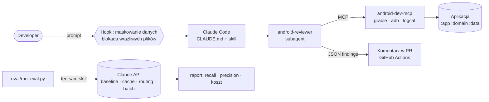

# android-ai-engineering

Praktyczny zestaw narzędzi AI dla zespołu Android w sektorze finansowo-ubezpieczeniowym: agent do code review, bezpieczne użycie AI z maskowaniem danych, własny serwer MCP i audyt kosztu i jakości wywołań modelu.

Motyw przewodni: aplikacja **„Zgłoszenie szkody”** (Kotlin, Jetpack Compose, MVVM + Clean Architecture, Hilt, Room, DataStore) — kod, na którym pracują agent, hooki i serwer MCP.

## Co tu jest

| Kompetencja | Gdzie | Status |
|---|---|---|
| Skill i agent AI wspierający development | [`.claude/skills/android-architecture-review`](.claude/skills/android-architecture-review), [`.claude/agents/android-reviewer.md`](.claude/agents/android-reviewer.md), [`CLAUDE.md`](CLAUDE.md) | ✅ |
| Wdrożenie agenta w CI (review PR) | [`.github/workflows/ai-review.yml`](.github/workflows/ai-review.yml) | ✅ — opt-in etykietą `ai-review` (płatne API), testy Androida zawsze |
| Audyt kosztu i jakości: routing, prompt caching, batching | [`eval/`](eval) | ✅ realny pomiar — [wyniki](#4-audyt-kosztu-i-jakości) |
| Bezpieczne użycie AI: klasy danych, dobór narzędzi, maskowanie | [`security/AI-usage-policy.md`](security/AI-usage-policy.md), [`security/masking`](security/masking), [`.claude/settings.json`](.claude/settings.json) | ✅ z testami |
| Integracje MCP | [`.mcp.json`](.mcp.json), własny serwer [`mcp/android-dev-mcp`](mcp/android-dev-mcp), [`docs/mcp.md`](docs/mcp.md) | ✅ z testami |
| bash / PowerShell | [`scripts/`](scripts) | ✅ |
| Aplikacja demo (Compose, Hilt, Room, DataStore, testy) | [`app/`](app), [`domain/`](domain), [`data/`](data) | ✅ |

## Architektura



## Szybki start

```bash
./scripts/setup.sh                 # macOS/Linux   (Windows: ./scripts/setup.ps1)
./scripts/run-eval.sh --dry-run    # symulacja audytu bez kosztów
export ANTHROPIC_API_KEY=...       # potem realny audyt:
./scripts/run-eval.sh
claude                             # Claude Code wczyta CLAUDE.md, skill, agenta, hooki i MCP
```

## 0. Aplikacja „Zgłoszenie szkody”

| Moduł | Zawartość |
|---|---|
| `:domain` | czysty Kotlin: `Money` (grosze, `Long`), `PolicyNumber` (value class z walidacją), reguły zgłoszenia (`ClaimRules`), `SubmitClaimUseCase` z wynikiem jako `sealed interface`, porty repozytoriów |
| `:data` | Room jako źródło prawdy, symulowane API ubezpieczyciela, DataStore (tylko dane niewrażliwe), Hilt, wstrzykiwany `@IoDispatcher` |
| `:app` | Compose + Material 3, MVVM (`StateFlow<UiState>` + zdarzenia przez `Channel`), Navigation, `collectAsStateWithLifecycle`, `FLAG_SECURE` na ekranach z danymi osobowymi |

Testy: use case’y i modele (JUnit), repozytorium (MockK), ViewModel (Turbine + `MainDispatcherRule`), formularz (Compose Test Rule).

```bash
./gradlew :domain:test :data:testDebugUnitTest :app:testDebugUnitTest
./gradlew :app:connectedDebugAndroidTest   # emulator / urządzenie
```

**Demo agenta:** `./scripts/create-demo-pr.sh` tworzy gałąź z celowo wadliwym ViewModelem ([`docs/demo`](docs/demo)). Review lokalnie, w ramach abonamentu Claude: `claude "Użyj agenta android-reviewer, żeby przejrzeć zmiany względem main"`.

## 1. Agent do code review

- **Skill** `android-architecture-review`: proces przeglądu, 4 checklisty (architektura, coroutines, stan i Compose, domena i bezpieczeństwo) i ścisły format wyniku w JSON. Checklisty ładowane są tylko wtedy, gdy dotyczą pliku.
- **Subagent** `android-reviewer`: ma uprawnienia tylko do odczytu, sam uruchamia testy przez MCP i zwraca znaleziska z plikiem, linią, kategorią, wagą i propozycją poprawki.
- **CLAUDE.md**: reguły projektu, których agent musi przestrzegać (warstwy, `Money` zamiast `Double`, testy, dane syntetyczne).
- **CI**: po dodaniu etykiety `ai-review` GitHub Action uruchamia Claude Code headless na zmienionych plikach `.kt` i publikuje komentarz w PR z tabelą uwag i kosztem przeglądu. Etykieta zamiast automatu = kontrola kosztu API.

## 2. Bezpieczne użycie AI

[Polityka](security/AI-usage-policy.md) definiuje 4 klasy danych (A–D), macierz „narzędzie × klasa danych” i standard maskowania. Polityka jest **egzekwowana kodem**:

- Hook `UserPromptSubmit` blokuje prompt zawierający PESEL, NIP, IBAN, kartę, e-mail, telefon, numer polisy lub szkody albo numer rejestracyjny. Użytkownik dostaje wersję zamaskowaną do ponownego wysłania.
- Identyfikatory z sumą kontrolną (PESEL, NIP, IBAN mod 97, Luhn) są walidowane, więc 11-cyfrowy numer builda nie zostanie uznany za PESEL.
- Hook `PreToolUse` i `permissions.deny` blokują agentowi odczyt eksportów danych, keystore i `local.properties`.
- Log decyzji zapisuje tylko **typy** wykrytych danych, nigdy wartości.

```
> Napraw walidację dla klienta 44051401359
Zablokowano: prompt zawiera dane wrażliwe (PESEL)…
Wersja zamaskowana do ponownego wysłania:
Napraw walidację dla klienta [PESEL]
```

## 3. MCP

Własny serwer **android-dev-mcp** (TypeScript, oficjalne SDK MCP) daje agentowi `gradle_test`, `gradle_lint`, `gradle_task`, `adb_devices`, `logcat_tail` i `run_ui_tests`:

- nie ma dowolnego shella, komendy są budowane z walidowanych parametrów i uruchamiane przez `execFile`;
- próby wstrzyknięcia (`:app; rm -rf /`) są odrzucane, co sprawdza test;
- dane osobowe w logcat są maskowane, zanim trafią do modelu;
- wyjście jest przycinane do 200 linii, co chroni kontekst i koszt.

Konfiguracja projektu w [`.mcp.json`](.mcp.json) obejmuje android-dev, GitHub i Figma. Szczegóły: [docs/mcp.md](docs/mcp.md).

## 4. Audyt kosztu i jakości

Zestaw ewaluacyjny w [`eval/dataset`](eval/dataset) to 4 pliki Kotlin z udokumentowanymi wadami:

| Przypadek | Wady |
|---|---|
| `CartViewModel` (God ViewModel) | 19 |
| `ClaimRepository` (bezpieczeństwo, coroutines) | 10 |
| `ClaimListScreen` (Compose) | 8 |
| czysty `SubmitClaimUseCase` | 0 — mierzy fałszywe alarmy |

Każdy wariant jest mierzony na tym samym zbiorze:

| Wariant | Hipoteza |
|---|---|
| `baseline` | punkt odniesienia |
| `caching` | stały prefiks (skill + checklisty) w cache, kolejne pliki płacą głównie za swój kod |
| `routing` | tani model odsiewa pliki niewymagające przeglądu, drogi model tylko dla ryzykownych |
| `batch` | Message Batches API dla nocnego przeglądu całego repo, wynik asynchronicznie, niższa stawka |

Mierzone są recall, precision, trafność kategorii, fałszywe alarmy na czystym pliku, tokeny (wejście, zapis i odczyt cache, wyjście) i koszt. Wynik trafia do [`eval/results/report.md`](eval/results).

### Wyniki — pierwsze uruchomienie (24.11.2026, Sonnet 5.5 + Haiku 5.5, łączny koszt ≈ 0,43 USD)

| Wariant | Recall | Precision | Koszt USD | vs baseline |
|---|---|---|---|---|
| baseline | 46% | 74% | 0,147 | — |
| caching | 46% | 81% | 0,127 | **−13%** |
| routing | 19% | 78% | 0,087 | **−41%** |
| batch | 43% | 64% | 0,065 | **−55%** |

Pełny raport: [`eval/results/report.md`](eval/results/report.md).

**Wnioski**

1. **Koszt:** batch + cache obniża koszt przeglądu o ponad połowę bez utraty jakości — dobry tryb dla nocnego przeglądu całego repo. Cache daje mniej, niż się spodziewałem (−13%), bo przy 4 plikach dominuje koszt *wyjścia* (~11 tys. tokenów), a cache tnie tylko wejście. Wniosek: przy review opłaca się skracać format odpowiedzi, a nie tylko prompt.
2. **Jakość:** na plikach, które się sparsowały, recall wyniósł **94%** (17/18 wad w `ClaimRepository` i `ClaimListScreen`). Niski recall ogółem to jeden plik — `CartViewModel` (19 wad) — którego odpowiedź za każdym razem była niepoprawnym JSON-em (kod Kotlina z cudzysłowami w treści + długa odpowiedź). Routing dodatkowo stracił `ClaimRepository`, bo tani model odpowiedział prozą zamiast JSON-em.
3. **Naprawa:** wynik jest teraz zwracany przez wymuszone wywołanie narzędzia (`tool_choice`) ze schematem JSON, z krótkimi polami tekstowymi i jawnym wykrywaniem obcięcia na `max_tokens`. Format nie zależy już od tego, czy model „pamięta”, żeby nie pisać prozy.
4. **Bezpieczeństwo kosztów:** skrypt sprawdza klucz przed startem (zły klucz = natychmiastowy błąd, nie 3 warianty wywołań), a koszt nieudanych wywołań też trafia do raportu.

Kolejny pomiar po zmianie formatu: `./scripts/run-eval.sh` (płatne, ~0,4 USD) albo `--dry-run` (bezpłatnie, sprawdza tylko pipeline).

## Struktura

```
.claude/            skill, subagent, hooki (settings.json)
.github/workflows/  AI review w CI + testy bezpieczeństwa
security/           polityka AI, maskowanie danych + testy
mcp/android-dev-mcp własny serwer MCP + testy
eval/               zestaw testowy, warianty, scoring, raport
scripts/            setup i eval (bash + PowerShell)
docs/               dokumentacja MCP
app/ domain/ data/  aplikacja demo „Zgłoszenie szkody”
```

Wszystkie dane w repo są syntetyczne.
